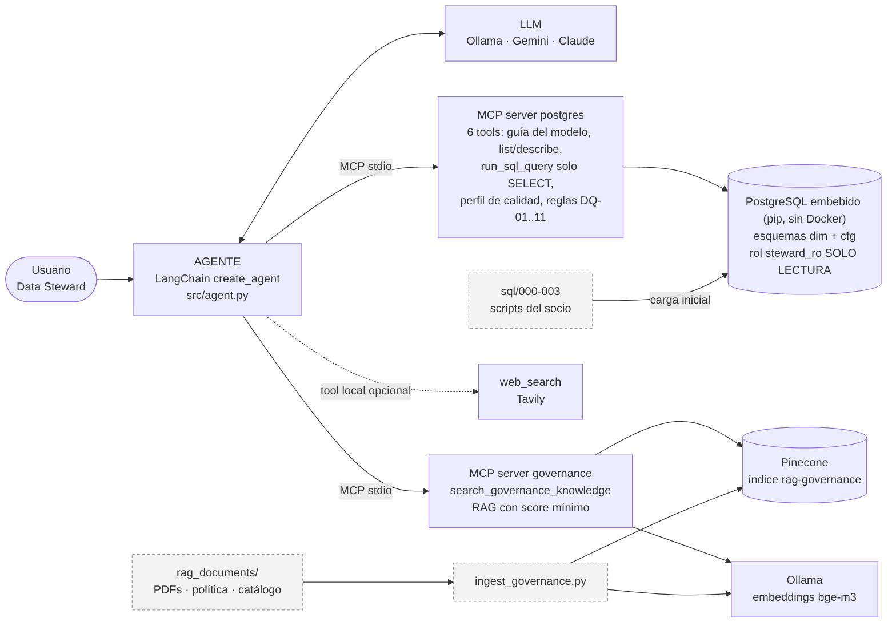

# Data Steward · Beta Sprint 2

Agente de **Data Steward** para un banco (datos sintéticos) que:

1. **Consulta y analiza una base PostgreSQL** generada con los scripts SQL del socio formador, a través de un **servidor MCP** (solo lectura).
2. **Fundamenta recomendaciones en gobernanza** con un **RAG** (Pinecone) sobre políticas, el marco de calidad GOV.UK/ONS y un catálogo de datos, expuesto por un **segundo servidor MCP**.
3. **Busca en internet (Tavily)** cuando la pregunta no trata ni de los datos ni de gobernanza.

Cada respuesta imprime la **traza de tools** (SQL ejecutado y extracto del resultado): es la evidencia de que el agente consume la base y no "adivina" desde el prompt.



---

## Instalación en 3 pasos (Windows)

**Requisitos previos:** [Python 3.11+](https://www.python.org/downloads/) (marca *Add to PATH*) y [Ollama](https://ollama.com/download) instalado y abierto. **No se necesita Docker ni instalar PostgreSQL.** No abras PowerShell como administrador.

**1. Crea el archivo `.env`** en la carpeta del proyecto con este contenido (cambia solo las dos claves):

```
PINECONE_API_KEY=pega_tu_clave_de_pinecone
TAVILY_API_KEY=pega_tu_clave_de_tavily
INDEX_NAME=rag-governance
MIN_SCORE=0.5
LLM_PROVIDER=ollama
LLM_MODEL=llama3.1:latest
EMBEDDING_MODEL=bge-m3
USE_EMBEDDED_DB=1
POSTGRES_DB=banco_sintetico
```

**2. Instala y prepara TODO con un comando** (abre PowerShell en la carpeta del proyecto):

```powershell
powershell -ExecutionPolicy Bypass -File .\setup.ps1
```

Esto: crea el entorno virtual, instala dependencias, arranca PostgreSQL embebido y carga los scripts del socio, descarga los modelos de Ollama, **crea el índice de Pinecone si no existe**, ingesta los documentos y corre un diagnóstico. La primera vez tarda varios minutos (descarga de `llama3.1`, ~5 GB). Es seguro repetirlo.

**3. Usa el proyecto:**

```powershell
.\run.ps1 demo                      # demo con 6 preguntas y traza de tools
.\run.ps1 ask "¿Cuál es el saldo total de TDC en junio de 2026?"
.\run.ps1 chat                      # chat interactivo
.\run.ps1 tests                     # 10 casos de prueba -> docs\RESULTADOS_PRUEBAS.md
.\run.ps1 pytest                    # 12 pruebas deterministas del servidor MCP de SQL
.\run.ps1 check                     # diagnóstico del entorno
.\run.ps1 raw                       # MCP sin LLM (plan B de la demo)
.\run.ps1 reload-db                 # regenera la base desde cero (cifras aleatorias nuevas)
.\run.ps1 stop-db                   # detiene PostgreSQL embebido (no borra datos)
```

> Mac/Linux: `bash setup.sh` y luego `./run.sh demo`.

### ¿Cómo funciona sin Docker?
El paquete `pixeltable-pgserver` trae un PostgreSQL 16 que se instala con `pip`. `db_config.py` lo arranca solo y guarda los datos **fuera del proyecto** (`%LOCALAPPDATA%\data-steward\pgdata`) para que OneDrive no lo sincronice. El entorno virtual también está fuera (`%LOCALAPPDATA%\data-steward\venv`). Si prefieres un PostgreSQL propio o en la nube: `USE_EMBEDDED_DB=0` y define `PGHOST`, `PGPORT`, `POSTGRES_USER`, `POSTGRES_PASSWORD` (admin) y `PGUSER`, `PGPASSWORD` (rol de solo lectura); luego `python scripts/load_db.py`.

### Problemas frecuentes
| Síntoma | Causa / solución |
|---|---|
| `la ejecución de scripts está deshabilitada` | Usa el comando completo con `-ExecutionPolicy Bypass` |
| `[FALLA] Ollama no responde` | Abre la app de Ollama (ícono en la bandeja) y repite `.\run.ps1 check` |
| `[FALLA] MCP->Pinecone ... NOT_IN_DOCUMENTS` o respuestas sin fuente | Calibra `MIN_SCORE` (baja a 0.3) y revisa los `score` que imprime la tool |
| El índice de Pinecone existe con otra dimensión | Cambia `INDEX_NAME` (se crea solo con dimensión 1024) |
| Quieres regenerar los datos (cifras nuevas) | `.\run.ps1 reload-db` |

---

## Estructura

```
├── setup.ps1 / setup.sh      instalación completa en un comando
├── run.ps1 / run.sh          atajos: demo, ask, chat, tests, pytest, check, raw, stop-db
├── .env.example              plantilla de variables
├── sql/                      000 esquema cfg (equipo) · 001-003 scripts del socio (sin modificar)
├── rag_documents/            PDFs GOV.UK / ONS + política y catálogo sintéticos (ver aviso)
├── src/
│   ├── db_config.py             PostgreSQL embebido o externo
│   ├── mcp_postgres_server.py   MCP server #1: base de datos (6 tools)
│   ├── mcp_governance_server.py MCP server #2: RAG de gobernanza (1 tool)
│   ├── agent.py                 agente LangChain + MCPAdapter + Tavily
│   ├── ingest_governance.py     documentos -> chunks -> embeddings -> Pinecone (crea el índice)
│   ├── run_test_cases.py        10 casos de prueba con evaluación automática
│   ├── mcp_raw_client.py        cliente MCP sin LLM
│   └── common.py                loaders + fábricas de LLM/embeddings
├── scripts/                  setup_all.py · load_db.py · check_setup.py · stop_db.py
├── tests/test_sql_server.py  12 pruebas deterministas del MCP de SQL
└── docs/                     arquitectura · casos de prueba · herramientas y fuentes · guía de demo
```

## Herramientas MCP

| Servidor | Tool | Función |
|---|---|---|
| postgres | `get_data_model_guide` | Guía semántica: joins, signos de transacciones, trampas conocidas |
| postgres | `list_tables` / `describe_table` | Esquema y muestra de datos |
| postgres | `run_sql_query` | Un único SELECT, validado, con timeout y tope de filas |
| postgres | `data_quality_profile` | % nulos, distintos, min/max por columna |
| postgres | `run_governance_checks` | Reglas DQ-01..DQ-11 ejecutables (pasa/falla + conteo) |
| governance | `search_governance_knowledge` | RAG con score mínimo; devuelve fuente y página/fila |
| local | `web_search` | Tavily (se activa si hay `TAVILY_API_KEY`), último recurso |

Detalle: [`docs/HERRAMIENTAS_Y_FUENTES.md`](docs/HERRAMIENTAS_Y_FUENTES.md) · Arquitectura: [`docs/ARQUITECTURA.md`](docs/ARQUITECTURA.md) · Demo: [`docs/GUIA_DEMO.md`](docs/GUIA_DEMO.md) · Pruebas: [`docs/CASOS_DE_PRUEBA.md`](docs/CASOS_DE_PRUEBA.md)

## Seguridad

- El MCP de SQL usa el rol **`steward_ro`** (solo `SELECT`), sesión `default_transaction_read_only=on` y `statement_timeout`; además valida **una sola sentencia SELECT/WITH** y limita las filas.
- `pytest` verifica que `DROP/DELETE/UPDATE/INSERT` y sentencias encadenadas son rechazadas y que la BD queda intacta.
- `.env` está en `.gitignore`; solo se versiona `.env.example`. **No hay credenciales en el código.**

## Hallazgos sobre los scripts SQL del socio

Se ejecutaron sobre PostgreSQL 16: 5,000 clientes, 20,000 cuentas, 225,000 transacciones y 120,000 saldos; **todas sus validaciones internas pasan**. Observaciones:

1. **El script 002 requiere el esquema `cfg`, que el 001 no crea** (falla con `schema "cfg" does not exist`). Se añadió `sql/000_crear_esquema_cfg.sql`; los scripts del socio no se modificaron.
2. Los scripts **no son re-ejecutables** (`CREATE TABLE` sin `IF NOT EXISTS`; el 001 hace `DROP`). `load_db.py --force` borra `dim`/`cfg` y regenera.
3. **Inconsistencia real:** `dominio` en saldos vale `CAPTACION/COLOCACION` en enero y `DEPOSITS/LENDING/TDC` de febrero a junio (hallazgo DQ-07/DQ-08).
4. Seis columnas de `dim_cliente` quedan 100% NULL (`giro_empresa`, `cve_territorio`, `cve_dir`, `cve_subdir`, `cve_sucursal`, `cve_promotor`) → DQ-10; impide análisis por sucursal/territorio.
5. No hay transacciones de enero (solo feb-jun) y todas caen el día 15.

> Conviene confirmar con el socio si (3) y (4) son intencionales; funcionan muy bien como casos de prueba.

## Estado y limitaciones

- Validado con PostgreSQL real (Linux): carga desde cero con la BD embebida, servidor MCP de SQL, descubrimiento multi-servidor con `MCPAdapter`, bucle del agente y trazas (con un modelo guionado) y 12 pruebas pytest.
- **No validado en este entorno** (requiere tus claves/servicios/Windows): Pinecone, Ollama, Tavily, respuestas de un LLM real y la ejecución en Windows de `setup.ps1` y del PostgreSQL embebido. `.\run.ps1 check` lo verifica en tu máquina.
- `langchain.mcp` está en **beta** (emite un aviso). Un LLM local de 8B (llama3.1) puede equivocarse en SQL complejo o al combinar dos fuentes; para la demo considera `LLM_PROVIDER=google|anthropic` (instala `langchain-google-genai` o `langchain-anthropic` y agrega su API key).
- `bge-m3` es multilingüe (el proyecto base usaba `bge-large`); si cambias de modelo, reingesta con `--reset`.
- `politica_calidad_datos_sintetica.md` y `catalogo_datos_sintetico.csv` **son ejemplos escritos por el equipo**, no políticas de Banamex: reemplázalos por los oficiales.

## Plan de commits incrementales (sugerido)

1. `chore: estructura, requirements, .gitignore y .env.example`
2. `feat(db): scripts SQL del socio + esquema cfg + PostgreSQL embebido (db_config, load_db)`
3. `feat(mcp): servidor MCP de PostgreSQL (tools y validación de solo lectura)`
4. `test: pruebas pytest del servidor MCP de SQL`
5. `feat(rag): ingesta a Pinecone y servidor MCP de gobernanza`
6. `docs(rag): política y catálogo de datos de ejemplo`
7. `feat(agent): agente multi-MCP con traza de tools y Tavily`
8. `test: casos de prueba y reporte de resultados`
9. `chore: scripts de instalación (setup/run) y documentación`

## Entrega final (local vs. nube)

Compara **PostgreSQL local/embebido** vs. **PostgreSQL gestionado** (Cloud SQL / RDS / Neon / Supabase) en costo, rendimiento, escalabilidad, privacidad (datos reales de un banco no deberían salir de su perímetro) y mantenimiento (backups, parches, alta disponibilidad). Cambiar de uno a otro solo requiere `USE_EMBEDDED_DB=0` y las variables `PG*` (con `PGSSLMODE=require` en la nube), porque el acceso pasa por el servidor MCP.

## Fuentes de gobernanza
UK Government Data Quality Framework y su guía (GOV.UK) · ONS Data Quality Management Policy · política y catálogo sintéticos del equipo.
