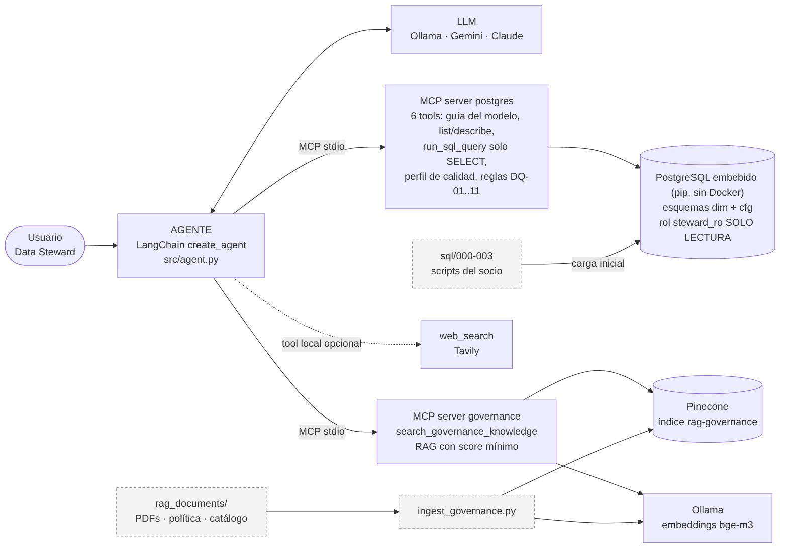

# Arquitectura

## Flujo de una pregunta
1. El usuario pregunta al **agente** (`src/agent.py`, LangChain `create_agent`).
2. Al iniciar, el agente abre **dos servidores MCP por stdio** con `langchain.mcp.MCPAdapter` y **descubre sus tools** (`tools/list`); no están "cableadas" en el agente. Los nombres quedan con prefijo del servidor: `postgres_*`, `governance_*`.
3. El **LLM decide** qué tool llamar según el prompt de sistema y las descripciones de cada tool.
4. Para **datos**: `postgres_get_data_model_guide` → `postgres_run_sql_query` (o perfil/reglas). El servidor MCP ejecuta el SQL en PostgreSQL con un rol de solo lectura y devuelve una tabla markdown.
5. Para **gobernanza**: `governance_search_governance_knowledge` embebe la consulta (Ollama), busca en Pinecone y devuelve fragmentos con fuente y score.
6. Preguntas **mixtas** (p. ej. "¿qué reglas fallan y qué hago?"): primero el hallazgo desde la BD, luego la recomendación fundamentada con el RAG.
7. El agente responde y el script imprime la **traza** (tool, argumentos, extracto del resultado).

## Decisiones de diseño
| Decisión | Motivo |
|---|---|
| SQL detrás de un servidor MCP (no dentro del agente) | Desacopla datos y agente: cualquier cliente MCP puede reutilizarlo; un solo punto donde aplicar seguridad |
| Rol `steward_ro` + validación SELECT + timeout + tope de filas | Defensa en capas contra escrituras y consultas costosas |
| `get_data_model_guide` | Evita que el LLM caiga en trampas del modelo (join de `dim_txn`, `cve_mes_alta`, signo de transacciones, `dominio`) |
| `run_governance_checks` con reglas DQ-01..11 | Reglas deterministas y auditables; el LLM solo las interpreta |
| Dos servidores MCP (datos / gobernanza) | Separa fuentes con distinto ciclo de vida y permisos |
| Embeddings `bge-m3` | Corpus mixto español/inglés (el base usaba `bge-large`) |
| LLM configurable (`LLM_PROVIDER`) | Permite cambiar de modelo local a uno más fuerte sin tocar código |
| Pinecone sin cambios respecto al proyecto base | Reutiliza el RAG ya construido |
| PostgreSQL **embebido** (`pixeltable-pgserver`, vía pip) | Cero instalación y sin Docker; los datos viven fuera del proyecto (`%LOCALAPPDATA%\data-steward\pgdata`). Con `USE_EMBEDDED_DB=0` se usa un PostgreSQL externo/en la nube sin cambiar código |

## Qué cambió respecto al proyecto base
- `11_mcp_rag_server.py` → `mcp_governance_server.py` (filtro de score, fuente+score en la salida, modelo de embeddings configurable).
- **Nuevo** `mcp_postgres_server.py`: el proyecto base **no** tenía acceso a SQL por MCP; su único servidor MCP era el del RAG.
- `13_mcp_langchain_agent.py` (un servidor) → `agent.py` (dos servidores + Tavily opcional + traza).
- `requirements.txt` ahora incluye `fastmcp>=4.0.11` (sin él, `from langchain.mcp import MCPAdapter` falla) y `psycopg`.
